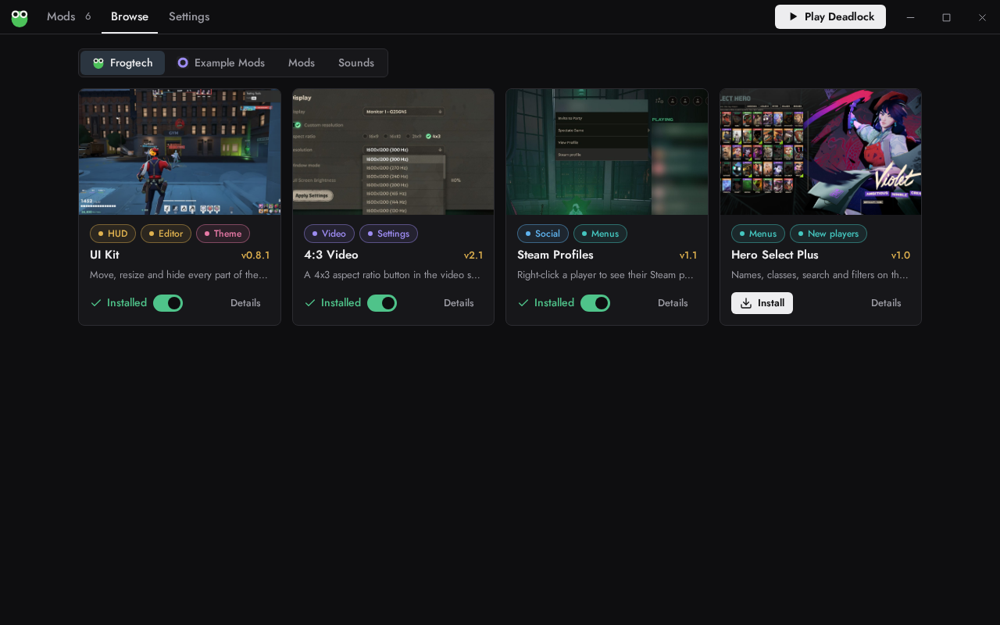

# Frogtech Mod Loader

A mod loader and auto-updater for [Deadlock](https://store.steampowered.com/app/1422450/Deadlock/) on Windows: install mods from Frogtech, GameBanana and other modders, and keep them working after game updates.



## Download

Get it at **[mods.frogtech.dev/mod-loader](https://mods.frogtech.dev/mod-loader)**, or from [Releases](https://github.com/fr0gtech/frogtech-mod-loader/releases). It runs on Windows 10 and 11.

## Features

- Keeps your mods switched on after every Deadlock update.
- Browse and install mods from Frogtech, GameBanana (mods and sounds) and repositories you add.
- Updates your mods and itself automatically, only while the game is closed.
- Turn mods on and off, and drag to choose which one wins when two change the same thing.
- Add your own `.zip`, `.rar`, `.7z` or `.vpk` files, or install with one click from a website (`frogmod://` links).
- Runs quietly in the tray and tells you when there's something new.

## Is it safe?

It's open source, and every release is built by GitHub Actions from this code with a signed provenance attestation. Check a download with the [GitHub CLI](https://cli.github.com/):

```
gh attestation verify FrogLoader_v0.5.1.zip --repo fr0gtech/frogtech-mod-loader
```

You can also compare it with `SHA256SUMS` on the release page. The exe isn't code-signed, so Windows may warn you the first time: choose **More info → Run anyway**.

## Build it yourself

You need [Go 1.23.12](https://go.dev/dl/) (see `.go-version`).

```
git clone https://github.com/fr0gtech/frogtech-mod-loader
cd frogtech-mod-loader
./build.sh        # dist/FrogLoader.exe and dist/FrogLoader_v<version>.zip
```

Builds are reproducible: building a release tag gives the same SHA-256 as the release. See [CONTRIBUTING.md](CONTRIBUTING.md) for development.

## For modders

You can ship your mods and updates through the loader with a repository: see the [format](https://mods.frogtech.dev/docs/repositories) and the [template](https://github.com/fr0gtech/frogmod-repository).

## License

[MIT](LICENSE). Third-party licenses are in [THIRD_PARTY_NOTICES.txt](THIRD_PARTY_NOTICES.txt).
